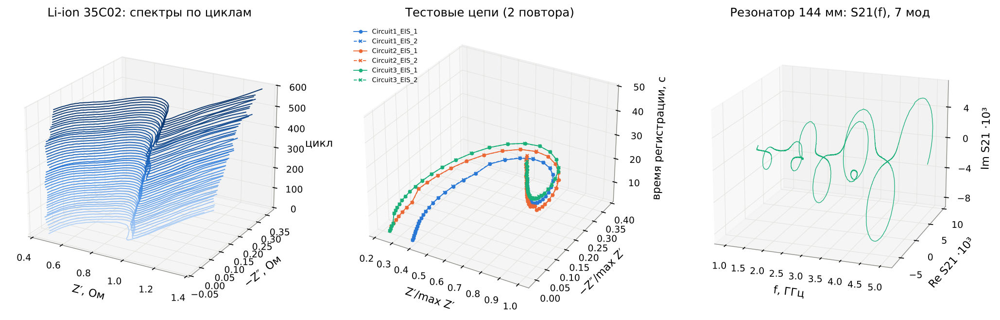
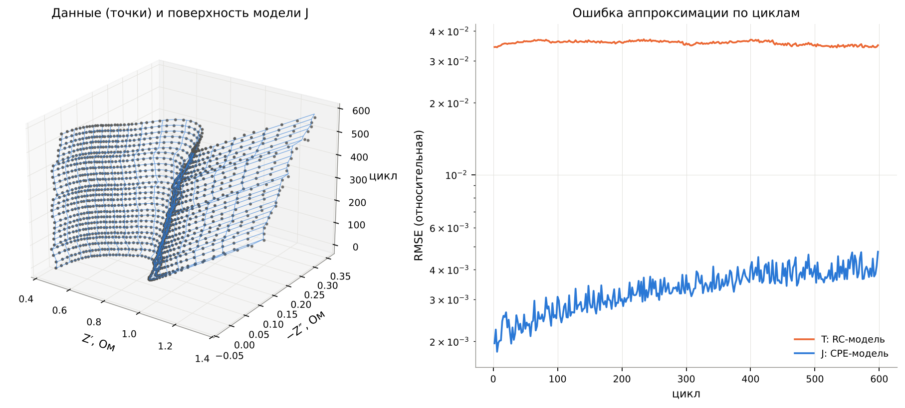

<div align="center">

# RLC-цепь: модель ОДУ в частотной области

**Лабораторная работа 1 · тема 6**<br>
учебная модель против дробной — на трёх реальных физических объектах

[](https://github.com/minashkinvladislav/RLC.lab/actions/workflows/tests.yml)


</div>

## Модель

**Учебная (T).** Последовательная RLC-цепь — линейное ОДУ второго порядка. Преобразование Лапласа превращает его в алгебраическое соотношение $`V(s) = Z(s)\,I(s)`$, а частотная область — это мнимая ось $`s = i\omega`$:

```math
L\,\ddot q + R\,\dot q + \frac{q}{C} = v(t)
\qquad\xrightarrow[\;q(0)\,=\,\dot q(0)\,=\,0\;]{\;\;\mathcal{L}\;\;}\qquad
Z_T(s) = R + sL + \frac{1}{sC}
```

**Журнальная (J).** Реальные конденсаторы и катушки описываются дробными производными — элементы $`L^{\beta}C^{\alpha}`$, или элементы постоянной фазы (CPE):

```math
L\,D^{\beta} i + R\,i + \frac{1}{Q}\,D^{-\alpha} i = v(t)
\qquad\Longrightarrow\qquad
Z_J(s) = R + L\,s^{\beta} + \frac{1}{Q\,s^{\alpha}},
\qquad 0 < \alpha,\beta \le 1
```

Учебная модель — частный случай журнальной; дробный порядок сдвигает резонанс и делает угол потерь не зависящим от частоты:

```math
Z_J\big|_{\alpha=\beta=1,\;Q=C} = Z_T,
\qquad
\omega_r = \left[\frac{\sin(\alpha\pi/2)}{Q\,L\,\sin(\beta\pi/2)}\right]^{\frac{1}{\alpha+\beta}},
\qquad
\tan\delta_{\mathrm{CPE}} = \cot\frac{\alpha\pi}{2}
```

Параметры $`\boldsymbol\theta`$ оцениваются по комплексному спектру взвешенным методом наименьших квадратов:

```math
\hat{\boldsymbol\theta} \;=\; \arg\min_{\boldsymbol\theta}\; \sum_{k} \frac{\bigl|\, Z(i\omega_k;\boldsymbol\theta) - Z_k \,\bigr|^{2}}{\lvert Z_k \rvert^{2}}
```

## Результаты

Данные трёх физически разных объектов скачиваются по HTTPS и проверяются по SHA-256.

| объект | ошибка T | ошибка J | вывод |
|:--|:-:|:-:|:--|
| физические цепи $`R_0 + (R_1 \parallel C_1)`$, 3 × 2 повтора | 0,07–0,25 % | 0,04–0,20 % | $`\hat\alpha \in [0{,}994;\,0{,}997]`$ — реальные конденсаторы слегка «дробные» |
| Li-ion элемент, 299 спектров за 598 циклов | ≈ 3,6 % | 0,2–0,5 % | дробный порядок необходим; сопротивление переноса заряда растёт вместе с деградацией ёмкости |
| полосковые резонаторы, 12 мод, 1–5 ГГц | 0,2–0,7 % | то же | по набору мод $`d\ln Q/d\ln f = 0{,}02 \pm 0{,}01`$ — как предсказывает модель J |

<p align="center">
  
  <br><sub>Данные в 3D: старение Li-ion элемента по циклам · тестовые цепи во времени регистрации · S₂₁ резонатора по частоте</sub>
</p>

<p align="center">
  
  <br><sub>Модель J по всем 299 спектрам и ошибка аппроксимации обеих моделей</sub>
</p>

## Запуск

```bash
pip install -r requirements.txt
make all        # данные → тесты → ноутбук → слайды, ≈ 6 мин
```

## Что внутри

| | |
|:--|:--|
| [`rlcfreq/`](rlcfreq) | модуль: символьные модели и графы (SymPy, networkx), векторные поля, подгонка параметров, решатели во временной области, загрузка данных |
| [`notebooks/`](notebooks/lab1_rlc_frequency.ipynb) | отчёт — исполненный ноутбук с графиками, доказательствами и выводами |
| [`slides/`](slides/slides.pdf) | презентация |
| [`tests/`](tests) | 96 тестов (pytest) |
| `figures/`, `results/` | рисунки и таблицы, которые создаёт ноутбук |
| [`ai/`](ai/AI_USAGE.md) | как использовался ИИ |

<sub>Код — MIT. Данные принадлежат их авторам: репозиторий их не хранит, а скачивает с закреплённых версий.</sub>
