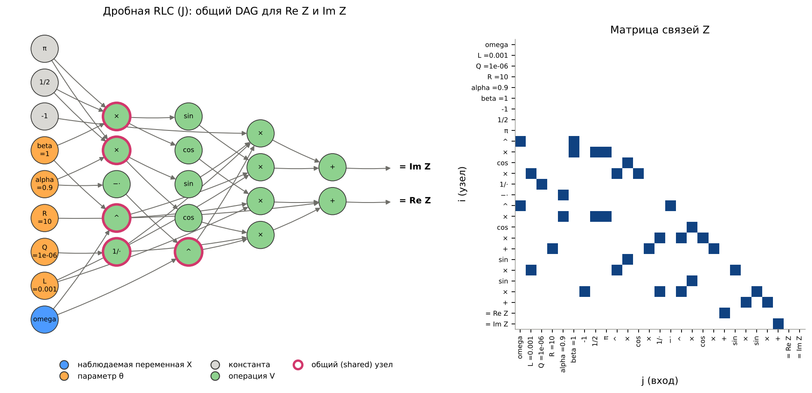
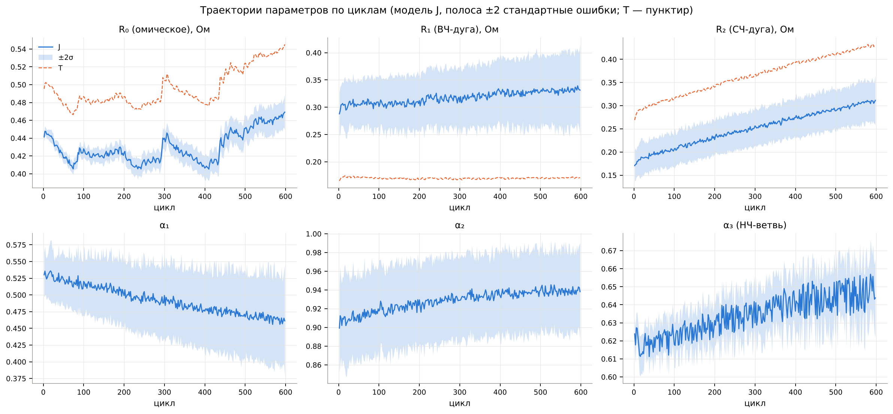
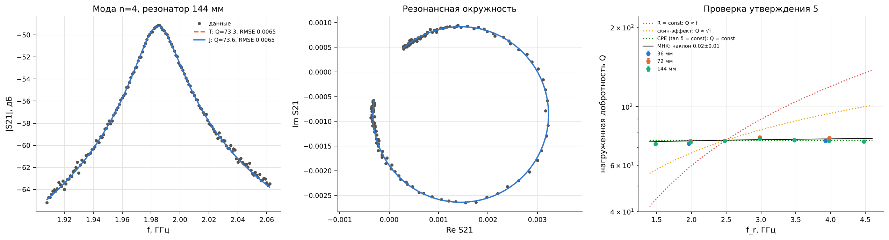

# RLC-цепь: модель ОДУ в частотной области

Лабораторная работа 1, тема 6 — *ODE models in the frequency domain: RLC circuit in electrical systems*.

Учебная модель — последовательная RLC‑цепь $L\ddot q+R\dot q+q/C=v(t)$, в частотной области $Z_T(s)=R+sL+1/(sC)$. Журнальная модификация — дробные элементы $L^{\beta}C^{\alpha}$ (элемент постоянной фазы, CPE): $Z_J(s)=R+Ls^{\beta}+1/(Qs^{\alpha})$ [Westerlund & Ekstam 1994; Radwan & Salama 2011; Wang et al., *Nat. Rev. Methods Primers* 2021]. Обе модели проверены на данных трёх физически разных объектов, скачиваемых по HTTP:

| источник | объект | данные |
|---|---|---|
| Zhang et al., *Nature Communications* 11, 1706 (2020) | Li‑ion элемент 35C02 | 299 спектров импеданса за 598 циклов, 20 кГц…0,02 Гц |
| Murbach et al., *JOSS* 5, 2349 (2020) — impedance.py | физические цепи $R_0$–$(R_1\|C_1)$ | 3 цепи × 2 повтора, 1 Гц…300 кГц |
| Arsenovic et al., *IEEE Microwave Mag.* 23(1) (2022) — scikit-rf | полосковые резонаторы 36/72/144 мм | $S$‑параметры VNA, 1–5 ГГц, 12 мод |

Отчёт — исполненный ноутбук [`notebooks/lab1_rlc_frequency.ipynb`](notebooks/lab1_rlc_frequency.ipynb); презентация — [`slides/slides.pdf`](slides/slides.pdf); описание использования ИИ — [`ai/AI_USAGE.md`](ai/AI_USAGE.md).

## Быстрый старт

```bash
python -m venv .venv && source .venv/bin/activate
pip install -r requirements.txt     # или: pip install -e ".[cma,test,notebook]"
make all                            # data -> test -> notebook -> slides (~6 мин)
```

Отдельные шаги: `make data` (скачать 11 файлов по HTTPS и проверить SHA‑256), `make test` (pytest), `make notebook` (выполнить ноутбук: через `jupyter nbconvert`, если он установлен, иначе — `tools/execute_notebook.py`, которому Jupyter не нужен), `make slides` (XeLaTeX). Сетевые тесты включаются явно: `RLCFREQ_NETWORK=1 pytest -m network`.

## Структура

```
rlcfreq/                 модуль (весь код классов и функций; ноутбук только вызывает его)
  circuit.py             грамматика схем, Z(s) в SymPy, граф цепи и узловой анализ
  models.py              вектор параметров (ParameterSpec), модели импеданса и S21, каталог моделей T/J
  symbolic.py            ОДУ -> Лаплас -> Z(s), дробный вариант, Re/Im, резонанс, tan δ, передаточные функции
  graph.py               DAG суперпозиции: словарь, позиционная матрица связей, networkx; граф цепи
  fields.py              векторные поля R^3 -> R^3: div, rot, якобиан, ·, ×, производная Ли, Лиувилль
  fitting.py             функция ошибки, TRF/LM/DE/CMA-ES/multistart, ковариация, AIC/BIC, продолжение по циклам
  timedomain.py          solve_ivp, схема Грюнвальда–Летникова, обратный Лаплас (Талбот), lock-in
  resonance.py           поиск и подгонка мод резонатора, ε_eff
  perturb.py             возмущения данных и структуры (задел ЛР 2–3, смешанные модели)
  data.py                реестр источников (закреплённые коммиты, SHA-256), загрузка, парсеры ZPlot/Touchstone
  plotting.py            оформление графиков
tests/                   96 тестов (pytest): аналитические решения, тождества, обратимость кодировок, калибровка
notebooks/               отчёт (исполненный ноутбук)
figures/, results/       рисунки и таблицы, создаваемые ноутбуком (CSV/JSON)
slides/                  презентация (Beamer, XeLaTeX)
ai/                      использование ИИ: промпт, инструменты, что проверено
tools/execute_notebook.py  исполнитель ноутбука без Jupyter
data/raw/                кэш скачанных файлов (не хранится в git)
```

## Соответствие требованиям

| требование | где выполнено |
|---|---|
| описание вычислительного эксперимента со списком источников | ноутбук, разд. 0 и «Источники»; этот README |
| данные загружаются по HTTP и присутствуют в списке источников | `rlcfreq/data.py` (`SOURCES`, `fetch`), ноутбук разд. 4, таблица источников |
| данные из двух–трёх разных источников | `zhang2020`, `impedancepy`, `skrf` |
| классы и функции в отдельном модуле | пакет `rlcfreq/` |
| комментарии и тесты | docstrings во всех модулях; `tests/` (96 тестов) |
| графики в ноутбуке с описанием | ноутбук: каждый рисунок с текстом и наблюдениями |
| код отделён от автора | устанавливаемый пакет, без путей и имён автора, каталог данных настраивается (`RLCFREQ_DATA_DIR`), лицензия MIT |
| части, созданные ИИ, с промптами, скиллами, проектами | `ai/AI_USAGE.md`, `ai/prompts/` |
| краткая презентация | `slides/slides.pdf` |
| уравнение и вариации из журнальной статьи | разд. 1.2: Westerlund–Ekstam, Radwan–Salama, Wang et al. (*Nature Rev. Methods Primers*) |
| уравнения и данные в 3D с учётом времени | разд. 3 (траектории поля по τ), 4.1 (данные: цикл / время регистрации / частота), 6.2 (поверхность модели по циклам), 8 (i(t, α), фазор I(t), Δv(t, цикл), затухание моды) |
| уравнение в виде графа (библиотека для графов) | разд. 2.2–2.4, `networkx` |
| базовый вариант как в учебнике, реальный — как в статье | модели T и J, разд. 1.4 |
| данные из нескольких источников для проверки вариативности | разд. 6.1–6.3, 7 |
| параметры в отдельном векторе с ожидаемыми значениями | `ParameterSpec`, `model.table()`, разд. 5.1 |
| выбор оптимизатора и солвера | разд. 5.2–5.3 (численное сравнение) |
| численное решение и подбор параметров | разд. 6, 8 |
| аппроксимация и вычисление ошибки | разд. 6–7 (RMSE, AIC/BIC, стандартные ошибки, корреляции) |
| график данных и аппроксимации | разд. 6 |
| цели: символьные представления, словарь и матрица смежности, поля R³→R³, уточнение параметров, структура для смешанных моделей | разд. 2, 3, 5–6, 9 |

## Основные результаты

| объект | RMSE, модель T | RMSE, модель J | ΔBIC (J − T) | вывод |
|---|---|---|---|---|
| физические цепи (6 спектров) | 0,07–0,25 % | 0,04–0,20 % | −50 … −110 | $\hat\alpha=0{,}994$–$0{,}997$: реальные конденсаторы слегка «дробные»; $\hat\beta\to1$ |
| Li‑ion, 299 спектров | 3,4–3,7 % | 0,2–0,5 % | ≈ −670 (цикл 2) | CPE необходим; $R_2$ растёт 0,17 → 0,31 Ом, $\rho(R_2,\text{ёмкость})=-0{,}99$ |
| резонаторы, 12 мод | 0,2–0,7 % | то же | $\lvert\Delta\rvert<1$ | по модам $d\ln Q/d\ln f=0{,}02\pm0{,}01$ ⇒ CPE‑диэлектрик, $\tan\delta_{\rm eff}\approx0{,}013$ |

Жадный поиск структуры по BIC (`perturb.structural_neighbours`) из учебной модели батареи через смешанные модели приходит к журнальной: `C3→Q3`, `C1→Q1`, `C2→Q2`.






## Воспроизводимость

* Данные: закреплённые коммиты GitHub, SHA‑256 каждого файла в `rlcfreq/data.py`; основной URL `raw.githubusercontent.com`, запасной `github.com/<repo>/raw/<commit>/...`. Данные не хранятся в репозитории (у репозитория Zhang et al. нет явной лицензии).
* Допущение о сетке частот `zhang2020`: в обработанных файлах статьи частоты не сохранены; сетка восстановлена как $f_k=2\cdot10^4\cdot10^{-6k/59}$, $k=0..59$, и проверена по частотам, опубликованным в статье и последующих работах (тест `test_zhang_frequency_grid_matches_published_values`).
* Стохастические алгоритмы: `seed=0`. Проверено на Python 3.13, numpy 2.5, scipy 1.18, sympy 1.14, networkx 3.6, matplotlib 3.11, pandas 3.0, mpmath 1.3, cma 4.0 (`requirements.txt`).
* Время полного прогона ноутбука ≈ 5 мин на одном ядре.

## Лицензия

Код — MIT (`LICENSE`). Данные принадлежат их авторам и распространяются по их лицензиям (CC BY 4.0 — Zhang et al. на Zenodo; MIT — impedance.py; BSD‑3 — scikit-rf); репозиторий их не содержит, а скачивает.

## Источники

1. Zhang Y., Tang Q., Zhang Y., Wang J., Stimming U., Lee A. A. Identifying degradation patterns of lithium ion batteries from impedance spectroscopy using machine learning. *Nature Communications* 11, 1706 (2020). doi:10.1038/s41467-020-15235-7; данные doi:10.5281/zenodo.3633835.
2. Wang S., Zhang J., Gharbi O., Vivier V., Gao M., Orazem M. E. Electrochemical impedance spectroscopy. *Nature Reviews Methods Primers* 1, 41 (2021). doi:10.1038/s43586-021-00039-w.
3. Westerlund S., Ekstam L. Capacitor theory. *IEEE Trans. Dielectr. Electr. Insul.* 1(5), 826–839 (1994). doi:10.1109/94.326654.
4. Radwan A. G., Salama K. N. Passive and active elements using fractional $L_\beta C_\alpha$ circuit. *IEEE Trans. Circuits Syst. I* 58(10), 2388–2397 (2011).
5. Murbach M. D., Gerwe B., Dawson-Elli N., Tsui L. impedance.py: A Python package for electrochemical impedance analysis. *JOSS* 5(52), 2349 (2020). doi:10.21105/joss.02349.
6. Arsenovic A., Hillairet J., Anderson J., Forstén H., Rieß V., Eller M., Sauber N., Weikle R., Barnhart W., Forstmayr F. scikit-rf: An open source Python package for microwave network creation, analysis, and calibration. *IEEE Microwave Magazine* 23(1), 98–105 (2022). doi:10.1109/MMM.2021.3117139.
7. Orazem M. E., Tribollet B. *Electrochemical Impedance Spectroscopy*. Wiley, 2008.
8. Pozar D. M. *Microwave Engineering*, 4th ed. Wiley, 2012.
9. Podlubny I. *Fractional Differential Equations*. Academic Press, 1999.
10. Abate J., Valkó P. P. Multi-precision Laplace transform inversion. *Int. J. Numer. Methods Eng.* 60, 979–993 (2004).
11. Self S. G., Liang K.-Y. Asymptotic properties of maximum likelihood estimators and likelihood ratio tests under nonstandard conditions. *JASA* 82, 605–610 (1987).
12. IPC-TM-650, method 2.5.5.5: Stripline test for permittivity and loss tangent at X-band. IPC.
13. Материалы курса (V. Strijov): <https://github.com/vadim-vic/Causal-Inference/tree/main/slides>.
